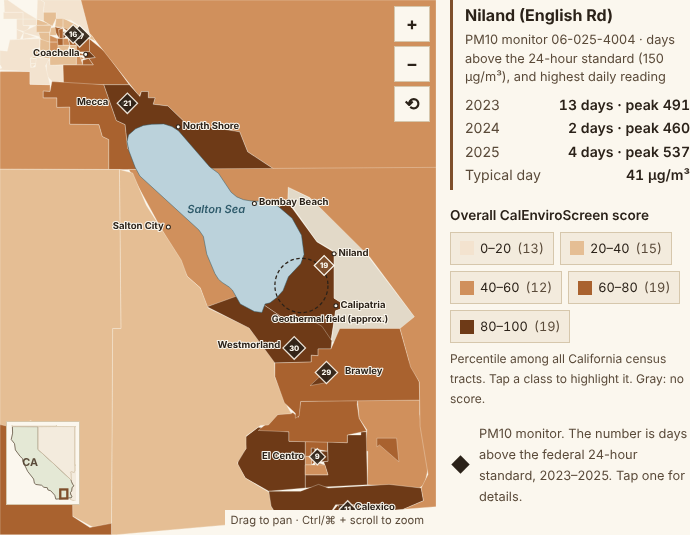

# Lithium Without the Dust: A GeoAI Plan for the Salton Sea

Research plan, code and data by Jhoven (Johan) Fernandez, part of *GeoAI for Cities* (draft, October 2026).

California wants lithium from the geothermal brine under the Salton Sea. The towns around the sea already
carry some of the heaviest health and poverty burdens in the state, and the sea is shrinking, exposing
lakebed that blows into those towns as dust. This project asks how much new lithium projects could add to
that dust, and which solutions would protect people best, using satellites, drones, air monitors and
predictive models.



**Narrated explainer (3:07):** [`media/lithium-explainer.mp4`](media/lithium-explainer.mp4) · captions: [`media/lithium-explainer.srt`](media/lithium-explainer.srt)  
**Page walkthrough (1:26):** [`media/lithium-walkthrough.mp4`](media/lithium-walkthrough.mp4)
**Interactive page:** [`page/index.html`](page/index.html) (open in a browser; no server needed)

## The question, as a chain

```
Project water use → less water reaching the sea → more exposed lakebed → more dust on windy days → who breathes it
```

In August 2026 a California appeals court found that Imperial County approved the largest proposed project
(Hell's Kitchen) without showing a 50-year water supply or addressing how its water use could affect air
quality near the sea. Each link in the chain above can be measured and predicted. That is the project.

## What is done and what is planned

| Part | Status |
|---|---|
| Burden map: CalEnviroScreen 4.0, 79 census tracts | **Done** (data in `data/`) |
| Dust monitors: EPA PM10, 8 sites, 2023–2025 | **Done** (summary in `data/raw/pm10_monitors_2023_2025.json`) |
| Case studies with drawbacks, solution sketches | **Done** (on the page; sources in `docs/SOLUTIONS.md`) |
| Model 3, dust-day forecast | **Code written and tested on synthetic data; not yet run on real data** |
| Models 1, 2, 4, 5 (shoreline, surface, exposure, ground) | Planned; see `docs/METHODS.md` |
| Drone surveys | Planned; see `docs/DRONE_OPS.md` |

## Key findings so far (from public data)

- 20 of the 79 tracts rank at or above the 85th percentile in California for asthma emergency visits; all 20 are in Imperial County.
- 44 of the 79 tracts rank at or above the 70th percentile for poverty, on every side of the sea.
- From 2023 through 2025, at least one of the eight PM10 monitors exceeded the federal 24-hour standard on 71 different days.
  Westmorland (30 days) and Brawley (29) had the most; Niland, closest to the geothermal field, had 19.
- Bad dust days cluster in April–May and September–October.
- PM2.5 ranks low around the sea, but lakebed dust is mostly coarser PM10, which CalEnviroScreen does not include.
- Monitors cannot say where dust comes from (lakebed, desert, farms). Separating sources is the main research gap.

## Repository layout

```
research/lithium/
├── README.md               this file
├── requirements.txt        Python packages
├── code/
│   ├── _paths.py                    shared paths and study area
│   ├── 00_decode_browser_pull.py    rebuild tracts from the saved browser snapshot (offline)
│   ├── 01_pull_calenviroscreen.py   pull the same tracts live from OEHHA's feature service
│   ├── 02_pull_epa_pm10.py          download and summarize EPA daily PM10
│   ├── 03_build_map.py              build the interactive map's SVG
│   ├── 04_pull_wind_asos.py         hourly airport wind → daily wind features
│   └── 05_dust_model_baseline.py    Model 3: dust-day prediction vs. two baselines
├── data/
│   ├── raw/        snapshots as pulled (CalEnviroScreen, PM10 summary, Salton Sea and state outlines)
│   └── processed/  outputs of the scripts
├── docs/
│   ├── DATA.md         every data source, fields, dates, and how each was pulled
│   ├── METHODS.md      the five models and how each is tested
│   ├── SOLUTIONS.md    dust and water solutions compared, with case studies and sources
│   └── DRONE_OPS.md    drone missions, rules and permissions checklist
├── media/          video walkthrough, solution sketches, screenshots
└── page/           the interactive web page
```

## How to run

```bash
pip install -r requirements.txt
cd code
python 00_decode_browser_pull.py          # offline: tracts from the snapshot
python 03_build_map.py                    # offline: map SVG
python 05_dust_model_baseline.py --synthetic   # offline: checks the model pipeline (results are meaningless)

# with internet access:
python 01_pull_calenviroscreen.py
python 02_pull_epa_pm10.py 2023 2024 2025
python 04_pull_wind_asos.py 2023-01-01 2026-01-01
python 05_dust_model_baseline.py          # real run
```

Scripts 01, 02 and 04 have not been run end to end from this workspace, which could not reach those
servers; the same pulls were made in a browser for the published numbers (see `docs/DATA.md`). Their
filtering and feature logic was tested offline on sample rows.

## Limits

- CalEnviroScreen indicators cover roughly 2015–2019 and are tract averages; large rural tracts hide local differences.
- Only eight EPA PM10 monitors, none on the exposed shoreline. Shoreline networks run by other agencies have not been checked for access.
- Days flagged as exceptional events (such as high winds) are kept in the PM10 counts on purpose.
- The geothermal field outline and town points on the map are approximate, for orientation only.
- The Natural Earth Salton Sea outline is an older shoreline, not today's.
- Solution ratings are qualitative, based on Owens Lake and the state program, not measured at the Salton Sea.
- Health links at the tract level are associations, not proof of cause.

## Sources

Full list in `docs/DATA.md` and `docs/SOLUTIONS.md`. Main data: OEHHA CalEnviroScreen 4.0; U.S. EPA AirData;
Natural Earth. Main context: inewsource and CalMatters (2026) on the Hell's Kitchen ruling; Lawrence Berkeley
National Laboratory (2023) on the lithium resource.
